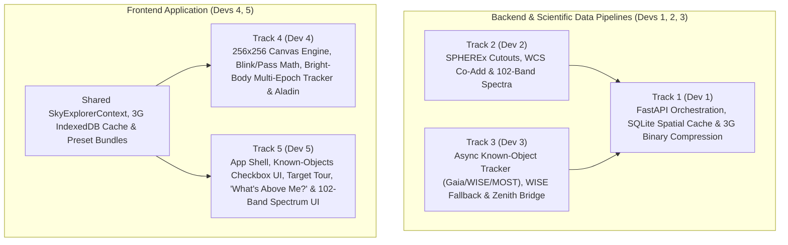

# Phase 2: Core Parallel Workstreams (Hours 2–9)

## 1. Phase Objective
All 5 developers execute their core domain tracks in parallel against the shared contracts from [Phase 0](file:///home/line/hackathons/star-hunters/plans/phase_0_master_architecture_shared_contracts.md) and the static presets from [Phase 1](file:///home/line/hackathons/star-hunters/plans/phase_1_foundation_scaffolding_and_presets.md). All issues are numbered in strict topological order (`ISS-01`–`ISS-22`) in [`/issues/README.md`](file:///home/line/hackathons/star-hunters/issues/README.md).

---

## Track 1: Backend API, 3G Binary Compression & SQLite Spatial Cache (`@14Emanuel`)

### Issue `ISS-03` (`[03]`): Quantized SQLite Spatial Cache with Capital City Cache & Automatic Size Pruning (`@14Emanuel`)
- **Assignee:** `@14Emanuel` (Backend Lead)
- **Blocked By:** None (`[]`)
- **Blocking:** `ISS-13`
- **Goal:** Persist preprocessed sky patch manifests, binary detector/flag buffers, asynchronous catalog overlays, 102-band spectra, and fallback capital city Zenith lookups in a local SQLite database keyed by a quantized spatial grid so repeat queries for the same neighborhood return in $<20\text{ ms}$ while keeping disk usage strictly bounded.
- **What the End Result Looks Like:**
  - Incoming `(ra, dec, fov_arcmin)` queries are quantized to a $0.05^\circ$ ($3\text{ arcminute}$) spatial grid key (`ra{ra_grid:.2f}_dec{dec_grid:.2f}_fov{fov:.1f}`) so nearby clicks share cached patches.
  - SQLite runs in `WAL` (Write-Ahead Logging) mode for fast concurrent reads/writes and stores `SkyPatchManifest` JSON, compressed binary frame blobs, cached spectra, and `capital_zenith_cache`.
  - Automatic Least-Recently-Used (LRU) pruning keeps total database size below a configurable cap (`MAX_CACHE_BYTES`, default $750\text{ MB}$) by evicting the oldest `last_accessed` sky patches when full.
  - An admin endpoint (`POST /api/v1/admin/clear-cache` protected by `X-Admin-Token`) allows clearing the cache on demand.

---

### Issue `ISS-13` (`[13]`): FastAPI Progressive Endpoints & 3G-Optimised Binary Frame Streaming (`@14Emanuel`)
- **Assignee:** `@14Emanuel` (Backend Lead)
- **Blocked By:** `ISS-03`, `ISS-05`, `ISS-06`, `ISS-07`, `ISS-08`, `ISS-09`, `ISS-12`
- **Blocking:** `ISS-21`, `ISS-22`
- **Goal:** Expose all Phase 0 REST endpoints with GZip compression, `Float16`/`Float32` binary frame streaming, strong `Cache-Control` headers for 3G/browser caching, and decoupled asynchronous catalog/cutout orchestration.
- **What the End Result Looks Like:**
  - `GET /api/v1/catalogs?ra={deg}&dec={deg}&fov={arcmin}`: Calls the asynchronous catalog & known-object tracking service (`known_objects`, `gaia_dr3`, `wise_sources`, `most_solar_system`) with a strict timeout ($\le 3.5\text{ s}$) and `Cache-Control: public, max-age=3600` so the frontend immediately populates the Known Celestial Objects Checkbox Menu and sky map overlays while FITS cutouts are still processing.
  - `GET /api/v1/sky-patch?ra={deg}&dec={deg}&fov={arcmin}`: Checks SQLite first; on cache miss, coordinates the SPHEREx pipeline and WISE fallback + known-object tracker, caches the preprocessed result in SQLite, and returns the complete `SkyPatchManifest`.
  - `GET /api/v1/frames/{grid_key}/{filename}?precision=float32|float16`: Streams raw `Float32Array` ($1,572,864\text{ bytes}$) or `Float16` ($786,432\text{ bytes}$) detector buffers and `Uint8Array` ($65,536\text{ bytes}$) flag masks with `GZipMiddleware` and `Cache-Control: public, max-age=31536000, immutable` so browsers cache raw frames permanently and never refetch them when user options change.
  - `GET /api/v1/spectrum?ra={deg}&dec={deg}` and `GET /api/v1/earth-to-sky` (with optional `lat`/`lon` and random capital city fallback + SQLite caching).

---

## Track 2: SPHEREx Scientific Pipeline & 102-Band Spectrophotometry (`@paowuor`)

### Issue `ISS-04` (`[04]`): SPHEREx IRSA Cutout Ingestion, `IMAGE - ZODI` Cleaning & `FLAGS` Masking (`@paowuor`)
- **Assignee:** `@paowuor` (Backend)
- **Blocked By:** None (`[]`)
- **Blocking:** `ISS-08`, `ISS-09`
- **Goal:** Query NASA/IPAC IRSA for SPHEREx Level 2 Multi-Extension FITS (MEF) cutouts covering `(ra, dec, fov_arcmin)`, remove the zodiacal light foreground (`ZODI`), and extract clean surface brightness and 8-bit artifact hygiene masks.
- **What the End Result Looks Like:**
  - Queries IRSA's CAOM-2 TAP service (`https://irsa.ipac.caltech.edu/TAP`) joining `spherex.artifact` and `spherex.plane` where `1 = CONTAINS(POINT('ICRS', ra, dec), p.poly)` across bandpasses `SPHEREx-D1` through `SPHEREx-D6`, fetching spatial cutouts via `https://irsa.ipac.caltech.edu/{uri}?center={ra},{dec}d&size={fov_deg}`.
  - Subtracts the modeled zodiacal dust extension (`HDU['IMAGE'].data - HDU['ZODI'].data`, in $\text{MJy/sr}$).
  - Maps the 32-bit SPHEREx `FLAGS` HDU into the 8-bit web hygiene mask defined in Phase 0 Section 3.3 (transient/cosmic ray, saturation, bad reference pixel, stray light/ghost) and masks corrupted/NaN pixels so they do not pollute co-added stacks.

---

### Issue `ISS-08` (`[08]`): Adaptive Epoch Clustering & 6-Detector WCS Co-Addition (`@paowuor`)
- **Assignee:** `@paowuor` (Backend)
- **Blocked By:** `ISS-04`
- **Blocking:** `ISS-12`, `ISS-13`, `ISS-20`
- **Goal:** Group cleaned exposures into comparison epochs and reproject/co-add all exposures per detector ($1\text{–}6$) onto a unified $256 \times 256$ tangential (`TAN`) WCS grid centered on `(ra, dec)`.
- **What the End Result Looks Like:**
  - **Adaptive Epoch Clustering:**
    1. When exposures span multiple 6-month survey passes ($\Delta\text{MJD} > 60\text{ days}$), groups them into distinct survey passes (`pass_1`, `pass_2`, etc.).
    2. When a sky patch only has exposures within a narrower window ($\Delta\text{MJD}$ between $1$ and $60\text{ days}$), splits them into earliest vs. latest observation clusters and records `baseline_days` in `data_source_summary`.
    3. When only a single SPHEREx epoch exists (or zero SPHEREx exposures cover the coordinate), signals the WISE/NEOWISE fallback module (`ISS-12`) to supply an archival baseline epoch so the user always gets at least 2 comparable epochs when possible.
  - Reprojects exposures in each `(epoch, detector)` bucket onto the shared $256 \times 256$ `TAN` WCS grid and combines them via inverse-variance weighting ($w_k = 1 / \sigma_k^2$) into a contiguous `(6, 256, 256)` `float32` buffer.

---

### Issue `ISS-09` (`[09]`): On-the-Fly 102-Band Forced Photometry & Molecular Feature Extractor (`@paowuor`)
- **Assignee:** `@paowuor` (Backend)
- **Blocked By:** `ISS-04`
- **Blocking:** `ISS-13`, `ISS-20`
- **Goal:** Extract a 102-channel near-infrared spectrum ($0.75\text{–}5.0\ \mu\text{m}$) at any clicked coordinate `(ra, dec)` and annotate key molecular absorption/emission features ($\text{H}_2\text{O}, \text{CH}_4, \text{CO}_2, \text{CO}$).

---

## Track 3: Multi-Mission Data (WISE/NEOWISE, Gaia DR3, MOST), Async Known-Object Tracker & Coordinate Bridge (`@14Emanuel`, `@Eddy-Odero`, `@paowuor`)

### Issue `ISS-05` (`[05]`): Earth-to-Sky Zenith Coordinate Bridge (`AltAz` $\rightarrow$ `ICRS`) & Random Capital City Fallback (`@14Emanuel`)
- **Assignee:** `@14Emanuel` (Backend Lead)
- **Blocked By:** None (`[]`)
- **Blocking:** `ISS-13`
- **Goal:** Convert any Earth location `(lat, lon)` and timestamp into the exact celestial coordinates `(RA, Dec)` and constellation directly overhead (the Zenith) to power the *"What's Above Me?"* experience. When user location data is unavailable or omitted, automatically pick a **random capital city** from `WORLD_CAPITAL_CITIES` (`is_fallback_capital: true`, `city_name`, `country`) and cache capital city Zenith lookups and overhead sky patches in the backend SQLite cache.

---

### Issue `ISS-06` (`[06]`): Asynchronous Multi-Mission Catalog Queries (Gaia DR3, WISE & NASA MOST) (`@14Emanuel`)
- **Assignee:** `@14Emanuel` (Backend Lead)
- **Blocked By:** None (`[]`)
- **Blocking:** `ISS-07`, `ISS-13`
- **Goal:** Asynchronously query Gaia DR3, WISE/NEOWISE, and NASA's MOST Solar System service in parallel (`asyncio.gather` with per-archive timeouts) for all cataloged objects inside the sky patch and project their coordinates onto the $256 \times 256$ WCS pixel grid `(x, y)`.

---

### Issue `ISS-07` (`[07]`): Backend Multi-Epoch Known-Object Trajectory Propagator & Default Selection Ranking (`@Eddy-Odero`)
- **Assignee:** `@Eddy-Odero` (Fullstack)
- **Blocked By:** `ISS-06`
- **Blocking:** `ISS-13`, `ISS-20`
- **Goal:** Synthesize the raw Gaia DR3, WISE, and MOST catalog results into the unified `catalog_overlays.known_objects` array (`KnownCelestialObject[]`), propagating each object's expected `(ra, dec, x, y)` position across every observation epoch (`epoch_positions`) and computing `default_checked` so only notable/moving objects are checked initially (keeping visual noise low).
- **What the End Result Looks Like:**
  - Propagates Gaia DR3 proper motions (`pmra`, `pmdec`) and MOST ephemerides to the exact MJD of each epoch (`pass_1`, `pass_2`, ...), storing `epoch_positions` in pixel coordinates `(x, y)` on the $256 \times 256$ WCS grid.
  - Cross-matches WISE infrared sources with Gaia DR3 within $2.5''$ to identify optical+IR stars vs. infrared-only brown dwarf candidates ($W1 - W2 \ge 0.8$ with no bright optical counterpart).
  - Sets `default_checked: true` for top notable objects (moving Solar System bodies from MOST, high proper-motion stars $\mu \ge 0.15''/\text{yr}$, infrared-only brown dwarf candidates, or the patch's primary showcase target, capped to $\le 8$ objects by default) and `default_checked: false` for stationary background stars.

---

### Issue `ISS-12` (`[12]`): WISE/NEOWISE Archival Cutout Fallback, Cross-Mission Baseline Reprojection & Capital City Patch Caching (`@paowuor`)
- **Assignee:** `@paowuor` (Backend)
- **Blocked By:** `ISS-08`
- **Blocking:** `ISS-13`, `ISS-20`
- **Goal:** Provide archival WISE/NEOWISE ($W1\ 3.4\ \mu\text{m}$ and $W2\ 4.6\ \mu\text{m}$) image cutouts reprojected onto the shared $256 \times 256$ `TAN` WCS grid whenever a queried coordinate has fewer than 2 SPHEREx epochs (or when user location data is unavailable and *"What's Above Me?"* picks a random capital city), and cache these capital city sky patches in the backend SQLite cache.

---

## Track 4: Interactive Sky Viewport, 3G Client Cache, Pixel Math & Bright-Body Tracker (`@atienosharzy-boop`)

### Issue `ISS-10` (`[10]`): 3G-Optimised Two-Tier Client Cache (Memory + IndexedDB) & Binary Frame Decoder (`@atienosharzy-boop`)
- **Assignee:** `@atienosharzy-boop` (Frontend Lead)
- **Blocked By:** None (`[]`)
- **Blocking:** `ISS-11`, `ISS-21`
- **Goal:** Build the frontend Two-Tier Cache (`in-memory Map` + persistent **IndexedDB** `star_hunters_patch_cache_v1`) and `Float16`/`Float32` binary frame decoder so raw sky patch data is fetched once over 3G and cached locally in the browser, enabling all user-configurable options to be calculated client-side without extra network calls.
- **What the End Result Looks Like:**
  - Decodes both `float32` ($1,572,864\text{ B}$) and `float16` ($786,432\text{ B}$) `.bin` detector buffers into `Float32Array[6]` per epoch, plus `Uint8Array` flag buffers.
  - Persists manifests, catalog overlays, spectra, and typed-array buffers in IndexedDB keyed by `grid_key` or `preset:{slug}` with automatic LRU eviction.

---

### Issue `ISS-11` (`[11]`): Client-Side 60 FPS Pixel Math & Wavelength "Dim & Pop" Engine (`@atienosharzy-boop`)
- **Assignee:** `@atienosharzy-boop` (Frontend Lead)
- **Blocked By:** `ISS-10`
- **Blocking:** `ISS-18`, `ISS-19`
- **Goal:** Transform cached `(6, 256, 256)` `Float32Array` epoch buffers and `(256, 256)` `Uint8Array` flag masks in the browser into `ImageData` at 60 FPS ($<5\text{ ms}$ per frame) with zero backend round-trips when epoch combinations, sliders, or modes change.
- **What the End Result Looks Like:**
  - Supports all 3 client-side epoch combination modes from `ViewportRenderSettings`:
    - **Blink Mode (`blink`):** Renders the currently active epoch `activeEpochIndex`.
    - **Pass Subtraction (`subtract`):** Computes $\Delta D_d(x, y) = D_{d, B}(x, y) - D_{d, A}(x, y)$ for any user-selected pair `(passAIndex, passBIndex)`.
    - **Co-Add Stack (`coadd`):** Averages any user-selected subset of passes (`coaddIndices`).
  - **Dynamic Wavelength "Dim & Pop" Colorization:** Weights Detectors $1\text{–}6$ across `wavelengthRangeUm: [min, max]` and applies `asinh` / `linear` / `zscale` stretch plus optional `showFlagsOverlay` tinting.

---

### Issue `ISS-14` (`[14]`): Aladin Lite v3 Global Sky Map Sync & Shareable URL State (`@atienosharzy-boop`)
- **Assignee:** `@atienosharzy-boop` (Frontend Lead)
- **Blocked By:** None (`[]`)
- **Blocking:** `ISS-21`
- **Goal:** Embed an interactive CDS Aladin Lite v3 sky map synchronized with the active SPHEREx cutout coordinates and keep the browser URL query parameters (`?target=...&ra=...&dec=...&fov=...&mode=...`) in sync for one-click link sharing.

---

### Issue `ISS-18` (`[18]`): Multi-Spot & Overlapped Bright-Body Detector, Colored Tracking Squares & Backward/Forward Multi-Frame Tracker (`@atienosharzy-boop`)
- **Assignee:** `@atienosharzy-boop` (Frontend Lead)
- **Blocked By:** `ISS-11`
- **Blocking:** `ISS-19`
- **Goal:** When a user clicks any spot `(clickX, clickY)` on the currently viewed image (`originEpochIndex`), automatically detect and highlight the local "bright" body in the general pixels in that area on that image, **track "overlapped" bodies** at the moment of clicking that separate in earlier or later epochs, assign **different tracking square colors** (`TRACKING_SQUARE_COLORS`) to each target, support **clicking multiple spots** (`trackedTargets`), and handle edge cases (`no_body_found`, `lost`, `low_snr`, `out_of_bounds`).
- **What the End Result Looks Like:**
  - **Local Bright-Body Peak Finder & Edge-Case Guard (Origin Frame):** Searches within `localRadiusPx` ($6\text{ px}$) around `(clickX, clickY)` on `originEpochIndex`. If no body exceeds `minSnrThreshold` ($3.0$), returns `status: 'no_body_found'` and `tracks: []` with a diagnostic message rather than creating a bogus track.
  - **Overlapped Body Separation & Backward/Forward Multi-Frame Tracking (`waypoints`):** Scans earlier and later epochs for multiple separated peaks (both stationary + moving overlap, close partially-separated pairs in the clicked area, and multiple diverging moving bodies blended at `originEpochIndex`), creating distinct `TracedObjectSummary` branches (`isOverlappedAtOrigin: true`) with different tracking square colors (`color`), and marks epochs where a body fades or leaves the FOV with `waypoint.status: 'lost' | 'low_snr' | 'out_of_bounds'`.
  - **Multi-Spot Tracking:** Accumulates clicked targets in `trackedTargets: TracedObjectSummary[]` with `removeTrackedTarget` and `clearTrackedTargets`.

---

### Issue `ISS-19` (`[19]`): Interactive $256 \times 256$ Viewport with Pan/Zoom, Colored Tracking Squares, Non-Looping Playback & Checked Known-Object SVG Overlays (`@atienosharzy-boop`)
- **Assignee:** `@atienosharzy-boop` (Frontend Lead)
- **Blocked By:** `ISS-11`, `ISS-16`, `ISS-18`
- **Blocking:** `ISS-21`
- **Goal:** Build the interactive $256 \times 256$ Canvas + SVG overlay viewport component with **panning and zooming** (`1x`–`8x`), non-looping playback controller, checked `known_objects` overlays, and **distinctly colored tracking squares** (`track.color`) for all clicked and overlapped targets (`trackedTargets`).
- **What the End Result Looks Like:**
  - **Interactive Panning & Zooming:** Synchronized `<canvas>` and `<svg>` zoom (`1.0..8.0`) and pan (`panX, panY`) via `clampViewportPanZoom`, `computeViewportViewBox`, and inverse click mapping `screenToImageCoordinates`.
  - **Non-Looping Time-Lapse Playback:** `isLooping` defaults to `false`, advancing from Pass 1 through Pass $N$ and pausing on the final frame.
  - **Checked Known-Object Highlighting & Labeling:** Renders markers, labels, and epoch-to-epoch motion tracks on the `<svg>` overlay for every object in `knownObjects` whose `object_id` is in `renderSettings.checkedObjectIds`.
  - **Multi-Target & Overlapped Colored Tracking Squares:** Renders a colored tracking square (`stroke={track.color}`) for each target/branch in `trackedTargets` at its per-epoch waypoint `(wp.x, wp.y)` (with dashed ghost squares when `wp.status !== 'tracked'`).

---

## Track 5: App Shell, Known-Objects Checkbox UI, Discovery Flows & 102-Band Spectral Inspector (`@Eddy-Odero`)

### Issue `ISS-15` (`[15]`): Application Shell, Target Tour Presets & *"What's Above Me?"* Zenith Flow (with Random Capital City Fallback) (`@Eddy-Odero`)
- **Assignee:** `@Eddy-Odero` (Fullstack)
- **Blocked By:** None (`[]`)
- **Blocking:** `ISS-16`, `ISS-17`, `ISS-21`
- **Goal:** Design and build the cohesive application shell, onboarding/preset tour selector for the 6 showcase targets, the *"What's Above Me?"* Earth-to-Sky discovery bar (with automatic **random capital city fallback** via `/api/v1/earth-to-sky` when user geolocation is unavailable/denied), and progressive/3G cache status indicators.

---

### Issue `ISS-16` (`[16]`): Viewport Controls Bar & Known Celestial Objects Checkbox UI (with Check All / Uncheck All) (`@Eddy-Odero`)
- **Assignee:** `@Eddy-Odero` (Fullstack)
- **Blocked By:** `ISS-15`
- **Blocking:** `ISS-19`, `ISS-21`
- **Goal:** Build the Viewport Controls Bar and the **Known Celestial Objects Checkbox Dropdown / Modal**:
  - **Comparison Mode, Pan/Zoom & Epoch Combination Controls:** Segmented controls for **Blink Epochs**, **Subtract ($\text{Pass } B - \text{Pass } A$)** (with epoch $A/B$ selectors), **Co-Add Stack** (with multi-epoch checkboxes), and pan/zoom buttons (`Zoom In`, `Zoom Out`, `Reset 1x`).
  - **Wavelength Range Slider ($0.75\text{–}5.0\ \mu\text{m}$) & Quick-Filter Pills:** Instant client-side wavelength filtering across Detectors $1\text{–}6$.
  - **Known Celestial Objects Checkbox Dropdown / Modal:**
    - Displays all `knownObjects` in the current view with catalog badges (`Gaia DR3`, `WISE`, `MOST`), object type, magnitude, and proper motion ($\text{arcsec/yr}$).
    - Provides one-click **Check All**, **Uncheck All**, and **Reset to Notable Movers** buttons, plus individual checkboxes bound to `renderSettings.checkedObjectIds` (`toggleKnownObject`, `checkAllKnownObjects`, `uncheckAllKnownObjects`) so users can selectively highlight and label known objects across every epoch image without triggering any backend calls.

---

### Issue `ISS-17` (`[17]`): Multi-Target Source Inspector, Scientist Drawer & 102-Band Spectral Plot with CSV Export (`@Eddy-Odero`)
- **Assignee:** `@Eddy-Odero` (Fullstack)
- **Blocked By:** `ISS-15`
- **Blocking:** `ISS-21`
- **Goal:** Display all `trackedTargets` with their distinct tracking square colors (`track.color`), overlapped-body branch badges (`isOverlappedAtOrigin`), backward/forward `waypoints` table across epochs (including `lost` / `low_snr` / `out_of_bounds` diagnostics and `no_body_found` alerts), measured proper motion ($\text{arcsec/yr}$), catalog match status or **"Uncataloged Infrared Mover Candidate"** badge, interactive 102-band spectrophotometry chart with shaded molecular bands ($\text{H}_2\text{O}, \text{CH}_4, \text{CO}_2, \text{CO}$), and CSV export.
